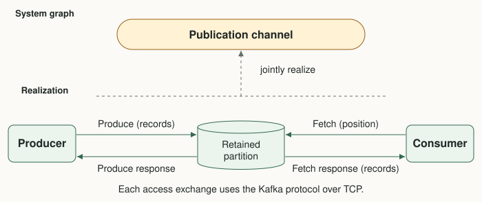

# Interaction Media

Classify a medium at a named boundary. TCP names a transport protocol, AMQP names a messaging protocol, and Kafka can name either a broker system or its client protocol. Each can appear in the realization of one [[Interaction Channels|interaction channel]]. The tables describe what the participants can exchange, which state connects them, and how they access it.

## Protocols and socket libraries

| Medium and boundary | Unit and exchange | Composition and scope |
| --- | --- | --- |
| TCP connection | Each peer reads and writes an ordered stream of bytes in each direction. | An application supplies record framing. A read can return part of one write or bytes from several writes. |
| UDP socket | A sender addresses individual datagrams to a destination. | Datagram boundaries survive delivery. Loss, reordering, and duplication are possible. |
| HTTP client and server | A request selects a target and method. The response carries a status and may carry content. | HTTP/2 commonly uses TLS over TCP. HTTP/3 maps the exchange to QUIC streams over UDP. The operation contract determines what a successful status establishes. |
| AMQP 1.0 link | A sender transfers deliveries to a receiver on a directed link. Link credit controls transfer. Dispositions report delivery state. | Sessions multiplex links over a connection. A link may attach to a broker queue or stream. The attached node and its configuration determine retention and distribution. |
| ZeroMQ socket pairings | Socket patterns select the exchange, including REQ/REP for request/reply, PUB/SUB for publication, and PUSH/PULL for work distribution. | A messaging library supplies message boundaries and pattern-specific routing over transports such as TCP, interprocess communication, or in-process memory. Peers can connect directly. Durable replay requires additional machinery. |

Protocol and library references: [TCP](https://www.rfc-editor.org/rfc/rfc9293), [UDP](https://www.rfc-editor.org/rfc/rfc768), [HTTP semantics](https://www.rfc-editor.org/rfc/rfc9110), [HTTP/3](https://www.rfc-editor.org/rfc/rfc9114), [AMQP 1.0 transport](https://docs.oasis-open.org/amqp/core/v1.0/os/amqp-core-transport-v1.0-os.html), [ZeroMQ socket patterns](https://zeromq.org/socket-api/).

## Broker and service boundaries

| Medium and mode | Participant-visible channel and state | Access exchange and progress |
| --- | --- | --- |
| Apache Kafka topic | Producers append records to partitions. Consumers can independently reread retained records by partition offset. | Kafka clients issue Produce and Fetch requests over TCP. A group's committed offset records a restart position. Reading a record leaves it in the log. |
| Azure Event Hubs | A partitioned event stream exposes retained events to independent consumer groups. | Clients can send and receive through AMQP 1.0 or the Kafka endpoint. HTTPS also supports sending. Readers can resume from a checkpoint. |
| Amazon SQS | A work queue makes messages available to competing workers. Standard queues allow duplicates and best-effort ordering. FIFO queues scope ordering to a message group. | Send, receive, and delete are service API requests over HTTPS. Receive starts a visibility timeout. Delete uses a receipt handle. An undeleted message can become visible again. |
| Azure Queue Storage | A work queue holds messages for workers. A retrieved message can become visible again when its visibility timeout expires. | The REST API exposes put, get, and delete. Deletion identifies the message and presents its current pop receipt. |
| Core NATS | A subject routes live publications to matching subscriptions. A queue group selects one member per matching group. | Clients publish and subscribe through NATS connections. A request can include a reply subject. Subscribers that miss a live publication have no replay position. |
| NATS JetStream | A configured stream captures publications on selected subjects. Retention policy governs which messages remain available. | A consumer tracks delivery state and can expose push or pull delivery. Its acknowledgment policy and the stream's retention policy determine the effect of acknowledgment. |

Service references: [Kafka protocol](https://kafka.apache.org/protocol/), [Event Hubs partitions and consumer groups](https://learn.microsoft.com/en-us/azure/event-hubs/event-hubs-features), [Event Hubs access protocols](https://learn.microsoft.com/en-us/azure/event-hubs/event-hubs-faq), [SQS visibility](https://docs.aws.amazon.com/AWSSimpleQueueService/latest/SQSDeveloperGuide/sqs-visibility-timeout.html), [Azure Queue Storage retrieval](https://learn.microsoft.com/en-us/rest/api/storageservices/get-messages), [Core NATS](https://docs.nats.io/nats-concepts/core-nats), [JetStream](https://docs.nats.io/nats-concepts/jetstream).

## One publication through Kafka

At the application boundary, a producer publishes a record and a consumer may observe it later. In the acknowledged Produce mode illustrated below, the record enters Kafka in a **Produce request** and leaves in a **Fetch response**. The consumer initiates the fetch. The retained partition connects the two exchanges across time, including when no consumer is connected at publication.

Each client uses the Kafka request/reply protocol over its own TCP connection in this example. One request can carry a batch. A successful Produce response reports acceptance under the selected acknowledgment setting. A producer using `acks=0` receives no Produce response. A Fetch response can return the record repeatedly while it remains retained. Committing an offset is another operation with its own failure boundary. A claim that an application effect occurred requires evidence at the application's [[Commit Boundaries|commit boundary]].

The same composition method works in the opposite direction. A Core NATS requester subscribes to a reply subject and publishes a request carrying that subject. A responder publishes its answer there. Those two publication directions realize a request/reply exchange. The [[Interaction Bindings|binding]] identifies the matching reply and the [[Interaction Protocols|protocol]] determines when the requester may consider the interaction complete.

## Formal relations

- `documents`: [[Interaction Channels]] — Classifies public media by the exchanges, retained state, and access paths that can realize a logical channel.
- `documents`: [[Interaction Bindings]] — Shows how an outer publication maps to different roles in two constituent client exchanges.
